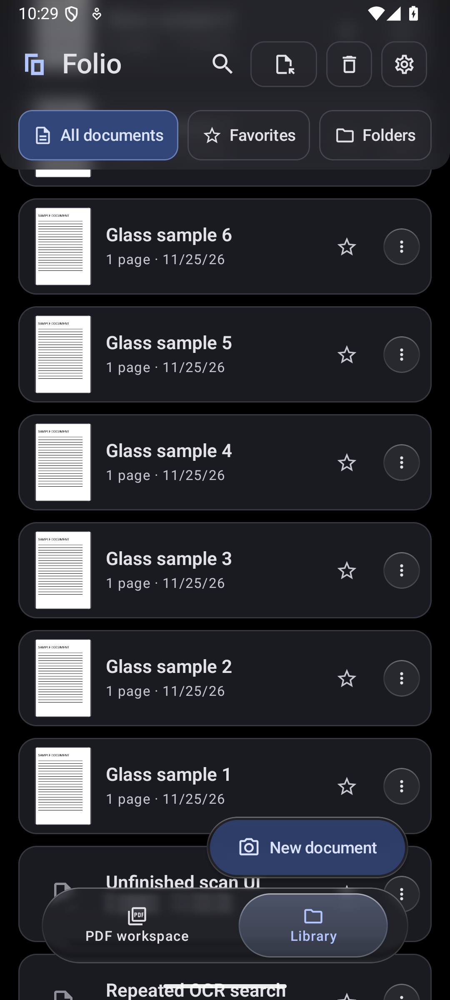
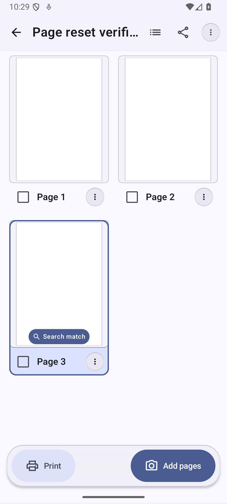

<h1>Folio</h1>

<strong>Your paper documents. A searchable library. Useful PDF tools.</strong>

An Android document scanner with offline OCR, retained originals, and a separate PDF Workspace.

Android 8.0+ · Kotlin &amp; Compose · Material 3 · AGPL-3.0

<a href="BUILDING.md">Build</a> · <a href="docs/GOOGLE_DRIVE_SETUP.md">Google Drive</a> · <a href="docs/MODELS.md">Models &amp; OCR</a> · <a href="PRIVACY.md">Privacy</a>

## Folio 2.2.1

Folio 2.2.1 brings a frosted interface to the Library, PDF Workspace, scanner, editors and sheets. Customize blur and translucency in Appearance. The Library supports date filtering, pinned favorites and a page highlight when you open a text match. The scanner supports tap-to-focus and starts the crop view closer to the document. Open **Settings → Backup** for offline ZIP export and restore.

## Screenshots and walkthrough

<table>
<tr>
<td align="center"> <b>Compact Library</b></td>
<td align="center"> <b>Search match in Light mode</b></td>
</tr>
</table>

The walkthrough shows an earlier version of the interface.

Earlier workflow screenshots: [PDF Workspace](docs/images/pdf-workspace.png), [page selection](docs/images/pdf-selection.png), [document OCR search](docs/images/ocr-search.png), and [PDF OCR search](docs/images/pdf-ocr-search.png).

## What you can do

| Workflow | Capabilities |
| --- | --- |
| **Scan & import** | Live LCNet corner detection, multi-page camera capture, image import, reviewed PDF import with a persistent PDF badge, manual corners with a magnifier, perspective correction. |
| **Edit** | Retained originals, crop zoom with a fixed magnifier, stacked enhancement presets with undo and redo, Before/After preview, and shared page sizing from the gallery or editor. |
| **Organize** | Folders, pinned favorites, created- and modified-date filters, grid and list views, sorting, long-press selection and page ordering. |
| **Read & search** | Offline PaddleOCR, background or on-demand extraction, library text search, selectable text, highlighted word/phrase matches with previous/next navigation. |
| **PDF Workspace** | Generate PDF from saved Folio PDF pages, image to PDF, merge, split, PDF to PNG, and edit a working copy: draw, rotate, reorder, remove or replace pages. |
| **Analyze PDFs offline** | Layout-Aware OCR with native text reuse or Full Page OCR using PaddleOCR directly, current-page/document processing, region/page copying and TXT export; original-image/vector figure extraction with a labeled PNG fallback; editable or layout-preserving DOCX conversion. |
| **Share & print** | Android Sharesheet, PDF/image exports, separate or combined documents, selected-page exports, Android print preview for all or selected pages. |
| **Recover** | Document/page Recycle Bin, restoration, permanent deletion, automatic removal after 60 days. |
| **Appearance** | Light, dark and AMOLED themes, frosted controls with adjustable translucency, and system dynamic colors on Android 12+. |

PDF replacement accepts an image or a selected PDF page, with a live **Match Page Size** preview. Exports offer quality/compression and password protection where supported. Larger PDF jobs provide progress, cancellation and interrupted-operation recovery.

The PDF Workspace works with device files independently of the library and exports new files; it does not overwrite the original device source PDF. Device and imported Folio PDFs open in a page gallery before editing. An initial import is saved only with **Save to Folio**; Back offers **Keep Importing** or **Discard Import**. The gallery supports grid/list views, individual or select-all page selection, and **Print**, **Share**, and **Export**. Selected outputs follow the current gallery order; without a selection, printing and exporting include every page. Long-press drag reorders pages when selection is inactive.

Returning from the editor to the gallery keeps the working copy and refreshes changed thumbnails. A warning appears when leaving a gallery with unsaved edits. Imported Folio PDFs can be explicitly saved to storage, overwritten transactionally in Folio, or saved as a new Folio PDF. The editor supports bounded pinch zoom and panning with aligned drawings. PDF editing is page manipulation and drawing, not editing existing PDF text.

**OCR PDF search** finds words and phrases across processed pages without running recognition again. Previous/next navigation wraps through the matches and updates both selectable text and the page preview. Layout-Aware results highlight the matching layout blocks; Full Page results use stored text-line boundaries. Preview highlights remain aligned while zooming and panning. These are region highlights, not estimated word-level boxes.

The new layout-analysis tools have a substantial memory requirement. DOCX reconstruction is best effort: ruled tables become editable cells where recognized, while ambiguous tables fall back to editable text with a warning.

## Get started

Android **8.0 / API 26+** is required. The universal ARM APK supports 32-bit and 64-bit ARM phones. See [BUILDING.md](BUILDING.md) to build it from source.

Open the downloaded APK and allow installation from that browser/file manager when Android asks.

Android checks the signing certificate when updating an installed copy. If your new APK uses a different certificate, export your data and verify the backup before uninstalling. [Signing and upgrade details](docs/RELEASE_SIGNING.md)

Open Folio, choose **New document**, and grant camera permission to scan. You can import images instead. Open **PDF workspace** to work with device PDFs and images. Scanning, editing, OCR and PDF tools require no account.

## Back up your library

Open **Settings → Backup → Local backup** to export your library to a ZIP or restore one from device storage. Local backup works offline.

### Google Drive Backup

**Google Drive Backup requires a configured OAuth client. Builds configured with an OAuth app in Testing are limited to that project's approved accounts.**

Accounts without approved access cannot use Google Drive Backup. Scanning, editing, OCR and PDF tools remain available without a Google account.

Backup is optional. Connecting an account does not upload your library. Automatic backup needs explicit opt-in. On a fresh installation, check for an existing backup before uploading. If one exists, restore it first. A verified empty account or completed cloud purge unlocks uploads; starting a new backup still requires your explicit choice. Read [the Drive guide](docs/GOOGLE_DRIVE_SETUP.md) before relying on backup.

## Built with

| Component | Version in this source release |
| --- | --- |
| Kotlin / Compose compiler | 2.4.20 |
| Android Gradle Plugin / Gradle | 9.4.1 / 9.6.0 |
| Compose BOM / CameraX | 2026.06.01 / 1.6.2 |
| Room / Hilt / WorkManager | 2.8.5 / 2.60.1 / 2.12.0 |
| OpenCV / ONNX Runtime Android | 4.14.0 / 1.30.0 |
| iText Community Android | 9.8.0 |
| PDFiumAndroidKt | 2.0.3 |

For source builds, see [BUILDING.md](BUILDING.md).

## Privacy and limitations

Document images and OCR stay on the device unless you explicitly share/export them or enable Drive backup. Folio contains no analytics or advertising integration. Android OS backup is disabled. See [PRIVACY.md](PRIVACY.md).

- OCR works best with printed English. Handwriting, mathematics, other languages and complex layouts may produce inaccurate results. Check extracted text for mistakes.
- OCR has a CPU fallback. NNAPI is requested on eligible devices; actual supported node execution varies. XNNPACK is CPU acceleration. GPU acceleration is not guaranteed.
- Exported PDFs do not currently embed an OCR text layer. Replacing a PDF page rasterizes that selected page; its vector/text content is not retained in the replacement.
- On a fresh installation, any existing Drive backup must be restored before uploads are unlocked.

## License and acknowledgements

Folio is distributed under [GNU AGPL v3](LICENSE). iText Community Android uses AGPL terms; retain applicable notices and provide corresponding source when distributing binaries. Its Android source archives are included in [third-party-sources](third-party-sources).

LCNet comes from [DocsaidLab DocAligner](https://github.com/DocsaidLab/DocAligner). Offline OCR uses the official [PaddlePaddle PP-OCRv6_small ONNX models](docs/MODELS.md). Their upstream licenses and provenance are recorded in [THIRD_PARTY.md](docs/THIRD_PARTY.md) and [bundled notices](app/src/main/assets/licenses). Bundled sample photographs are credited to MakeACopy.

For contributions, see [CONTRIBUTING.md](CONTRIBUTING.md). Report vulnerabilities privately as described in [SECURITY.md](SECURITY.md); never post private documents, credentials or account information in public issues.
